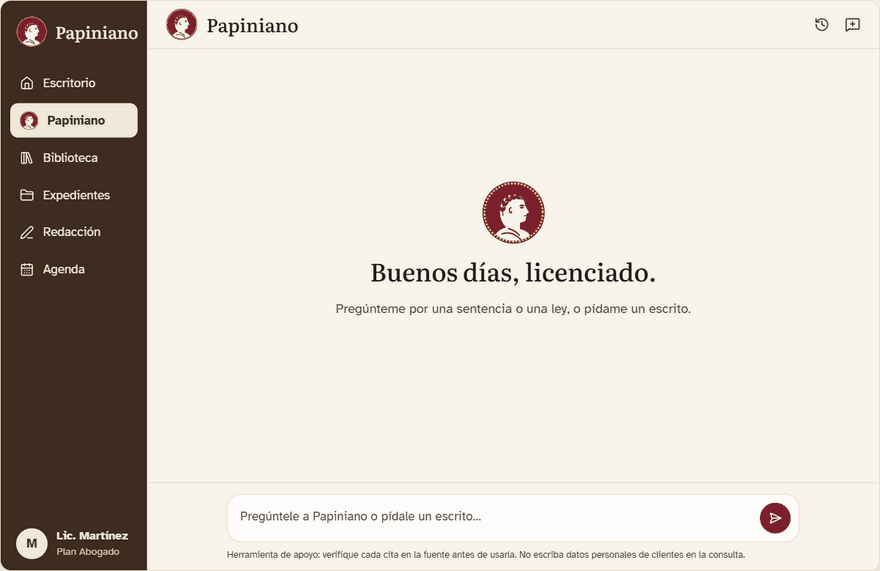

# Papiniano

**La oficina digital con inteligencia artificial para abogados de República Dominicana.**

Papiniano es un SaaS: el abogado le pregunta a su asistente como a un colega y le responde con las sentencias de la
Suprema Corte de Justicia y las leyes dominicanas, con la página exacta del documento oficial de cada cita. Además le
redacta el escrito en una hoja al lado de la conversación, guarda cada caso en su expediente y lleva la agenda de
audiencias y plazos. Un despacho con varios abogados lo comparte en una sola oficina.

<p align="center">
  
</p>
<p align="center"><sub>Papiniano por dentro: la misma animación de la página pública, con datos de ejemplo.
<a href="docs/papiniano.mp4">Verla en video (MP4)</a>.</sub></p>

> **De dónde viene.** Este repositorio nació como *Sistema de Solicitudes Legales*: un generador de documentos en Word
> y PDF para el departamento legal de una institución. En noviembre de 2026 evolucionó a Papiniano, un producto para
> cualquier abogado. Las plantillas institucionales siguen dentro de la app, en la sala Redacción, para las cuentas que
> las usan.

## En línea

[papinianord.com](https://papinianord.com/): la página pública con los planes, y la entrada con Gmail o con
usuario y contraseña. Hay 7 días de prueba gratis, sin tarjeta.

> De noche, la primera carga puede tardar unos segundos mientras el servidor despierta.

## Qué hay adentro

| Sala | Qué hace |
|---|---|
| **Papiniano** | El asistente. Busca en el Boletín Judicial y en los códigos, leyes y reglamentos, y responde con lo que dice la ley, la jurisprudencia y su análisis. Cada cita abre la página del PDF oficial dentro de la app. Redacta instancias, recursos y otros escritos en una hoja al lado, con modelos de escritos reales; el abogado le pide cambios y lo descarga en Word o PDF. Calcula las prestaciones laborales con las reglas del Código de Trabajo. |
| **Biblioteca** | Todo lo que Papiniano lee: el Boletín Judicial, los códigos y las leyes, y los documentos propios que sube cada abogado (solo él los ve). |
| **Expedientes** | Una carpeta por caso: cliente, asunto, número, tribunal, contraparte, quién lo lleva y notas, con sus fechas, sus conversaciones y escritos con Papiniano y sus documentos. |
| **Agenda** | Audiencias, plazos y reuniones, con el mes al lado. El Escritorio avisa lo que viene en la semana. |
| **Redacción** | Las plantillas institucionales de solicitudes (informe técnico, solicitud de archivo, reporte de audiencia y otras) y su historial, para las cuentas que las tienen activadas. |
| **Mi oficina** | En el plan Despacho, el dueño agrega a sus abogados por correo y ve cuánto usa cada uno, nunca lo que preguntan. Los expedientes y la agenda son de toda la oficina. |

## Planes

| Plan | Precio | Para quién |
|---|---|---|
| Aspirante | US$29 al mes o US$290 al año | Consultar sentencias y leyes a diario, con escritos cada mes usando los modelos de Papiniano. Sin documentos ni modelos propios, ni expedientes y agenda. |
| Abogado | US$59 al mes o US$590 al año | El trabajo de todos los días: muchas más consultas y escritos, sus modelos y documentos, expedientes y agenda. |
| Despacho | US$219 al mes o US$2,190 al año | Una oficina de hasta 10 abogados, el dueño incluido, con todo lo del plan Abogado y los expedientes y la agenda compartidos. |

Los límites de cada plan se configuran con variables de entorno (ver abajo). La página pública los describe con
palabras, no con números.

## Privacidad (Ley 172-13)

- Los datos personales de los clientes **no se le mandan a la IA**. Papiniano deja en los escritos los datos por llenar
  (`[NOMBRE DEL CLIENTE]`, `[CÉDULA]`…) y el abogado los completa en la app: se guardan solo en su equipo y se ponen al
  descargar el Word o el PDF.
- Los expedientes y la agenda se guardan en la base de Papiniano y tampoco pasan por la IA.
- La IA solo redacta con las fuentes encontradas, y se quitan las citas que no correspondan a una fuente real. Es una
  herramienta de apoyo: cada cita se debe verificar en la fuente.

## Cómo está hecho

| Parte | Tecnología |
|---|---|
| Pantallas | React, TypeScript, Vite, Tailwind CSS y shadcn/ui (`web/`) |
| Servidor | Python con FastAPI (`servidor.py`): la API y las pantallas ya armadas |
| Cuentas, conversaciones, expedientes y agenda | PostgreSQL en [Neon](https://neon.tech) (`DATABASE_URL`); sin la variable, SQLite local |
| Buscador de jurisprudencia | PostgreSQL con `pgvector`: búsqueda híbrida por palabras (texto completo en español) y por significado (vectores) |
| Inteligencia artificial | Groq para redactar; Cloudflare Workers AI para los vectores y de respaldo |
| Documentos | `python-docx` y `fpdf2` para Word y PDF; `pikepdf` y `pypdfium2` para mostrar la página citada sin descargar el PDF entero |
| Despliegue | Render (Python y Node) |

## Probar en local

Requiere Python 3.11 o superior y Node 20 o superior.

```bash
git clone https://github.com/yeisondev001/sistema-de-solicitudes-legales.git
cd sistema-de-solicitudes-legales
python -m pip install -r requirements.txt
python crear_usuario.py --admin
uvicorn servidor:app --reload --port 8000
```

En otra terminal:

```bash
cd web
npm install
npx vite --port 5180
```

Abra `http://localhost:5180`. Vite le pasa a Python todo lo que empieza con `/api`. Sin `JURIS_DATABASE_URL` la app
abre, pero el asistente no puede buscar sentencias.

## Variables de entorno

| Variable | Para qué |
|---|---|
| `DATABASE_URL` | Usuarios, sesiones, conversaciones, expedientes, agenda e historial (PostgreSQL / Neon). Sin ella se usa SQLite local |
| `JURIS_DATABASE_URL` | Base del buscador de jurisprudencia (PostgreSQL / Neon, proyecto aparte) |
| `JURIS_ARCHIVO_URLS` | Opcional: más bases para el Boletín cuando no cabe en una, separadas por espacios |
| `JURIS_LIMITE_MB` | Opcional: hasta cuántos MB se llena cada base (por defecto 850, del 1 GB gratis) |
| `IA_API_KEY` | Clave del proveedor de IA (por defecto Groq). Sin ella se muestran solo los fragmentos |
| `IA_BASE_URL`, `IA_MODELO`, `IA_MODELO_RAPIDO` | Opcional: cambiar de proveedor o de modelo (API compatible con OpenAI) |
| `CF_ACCOUNT_ID`, `CF_API_TOKEN` | Cloudflare Workers AI: vectores y respaldo de la IA. Sin ellas la búsqueda es solo por palabras |
| `EMB_MODELO`, `CF_MODELO_TEXTO` | Opcional: modelos de Cloudflare |
| `CODIGO_INSTALACION` | Obligatoria en el servidor para crear el primer administrador |
| `GOOGLE_CLIENT_ID`, `GOOGLE_CLIENT_SECRET` | Opcional: entrar con Google. La URL de redirección es `<dirección de la app>/oauth_callback` |
| `APP_URL` | Opcional: dirección pública de la app (en Render se toma de `RENDER_EXTERNAL_URL`) |
| `PRUEBA_DIAS`, `PRUEBA_PREGUNTAS_DIA` | Opcional: días de la prueba gratis (5) y consultas por día (200) |
| `POLAR_TOKEN`, `POLAR_WEBHOOK_SECRET` | Cobro con Polar (opcional; sin ellos «Mi plan» dice que el pago llega pronto). El aviso de Polar apunta a `<dirección>/api/pagos/aviso`. `POLAR_SANDBOX=1` usa el sandbox |
| `BASICO_PREGUNTAS_DIA`, `BASICO_ESCRITOS_MES` | Opcional: consultas por día (60) y escritos nuevos por mes (20) del plan Aspirante |
| `ABOGADO_PREGUNTAS_DIA`, `ABOGADO_ESCRITOS_MES` | Opcional: consultas por día (200) y escritos nuevos por mes (100) del plan Abogado y de cada abogado del Buffet |
| `PRUEBA_ESCRITOS_MES` | Opcional: escritos nuevos de la prueba gratis (100) |

Nunca suba al repositorio claves, contraseñas ni cadenas de conexión: van en las variables del servidor.

## Las fuentes

- **Boletín Judicial.** `cargar_boletines.py` descarga el Boletín mensual de la Suprema Corte, lo corta en sentencias,
  lo guarda con sus vectores y borra el PDF. En GitHub corre solo cada día (`.github/workflows/boletines.yml`, con los
  secretos `JURIS_DATABASE_URL`, `JURIS_ARCHIVO_URLS`, `CF_ACCOUNT_ID` y `CF_API_TOKEN`). Los vectores atrasados se
  pueden calcular de una vez con la GPU gratis de Kaggle (`kaggle/huellas.ipynb`).
- **Leyes y reglamentos.** `cargar_leyes.py` carga los códigos, las leyes y los reglamentos en el buscador con sus
  vectores. Los PDF quedan en `leyes/` y la app abre la página citada desde este repositorio.

```bash
python cargar_boletines.py                 # los meses publicados que falten
python cargar_boletines.py --mes 2025-05   # un mes concreto
python cargar_leyes.py                     # las leyes y reglamentos
```

## Estructura del proyecto

```text
├── servidor.py                 # API (FastAPI) y pantallas ya armadas
├── cuentas.py                  # Usuarios, planes, sesiones, conversaciones, escritos y oficinas
├── expedientes.py              # Expedientes y agenda (compartidos por oficina)
├── historial.py                # Historial de reportes de audiencia (plantillas)
├── redaccion.py                # Las plantillas institucionales de Redacción
├── modelos/                    # Modelos de escritos (sin datos reales) y su catálogo
├── jurisprudencia/             # Buscador, IA, visor de páginas, leyes y prestaciones
├── leyes/                      # PDF de códigos, leyes y reglamentos
├── generators/                 # Word y PDF de las plantillas y del historial
├── web/                        # Pantallas en React (ver web/README.md)
├── cargar_boletines.py         # Cargar el Boletín Judicial y sus vectores
├── cargar_leyes.py             # Cargar las leyes
├── crear_usuario.py            # Crear usuarios desde la terminal
├── kaggle/huellas.ipynb        # Vectores atrasados con GPU de Kaggle
├── main.py                     # La app anterior en Flet (ya no es la que corre en Render)
├── render-build.sh             # Build de Render
└── ESTADO_DEL_PROYECTO.md      # Por dónde va el trabajo y qué falta (leer primero)
```

## Despliegue

En Render, como servicio web:

- **Build Command:** `bash render-build.sh` (instala lo de Python y arma las pantallas en `web/dist`).
- **Start Command:** `uvicorn servidor:app --host 0.0.0.0 --port $PORT`.

## Contribuir

Antes de cambiar algo, lea [ESTADO_DEL_PROYECTO.md](ESTADO_DEL_PROYECTO.md) y [CONTRIBUTING.md](CONTRIBUTING.md). No
suba expedientes, cédulas, escritos con datos reales ni otros datos personales.

## Licencia

Software privado. Todos los derechos reservados: no se permite copiarlo, modificarlo, distribuirlo ni usarlo sin
autorización escrita del titular (ver [LICENSE](LICENSE)).
